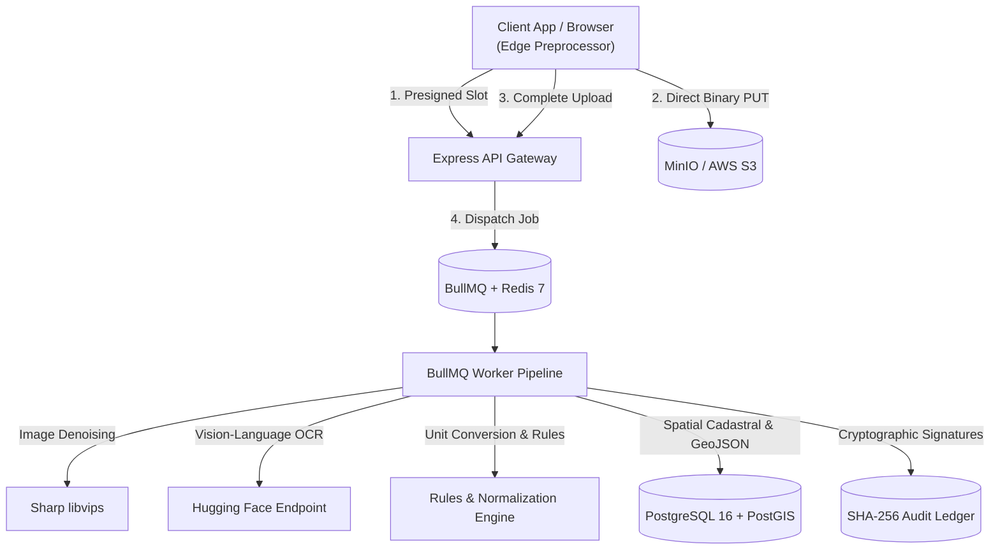

# BhumiSetu (भूमिसेतु) 
**Intelligent Land Record Digitization, Validation & Spatial Governance System**  
*Developed for Smart India Hackathon (SIH Problem Statement 26018) | Aligned with DILRMP & ULPIN (Bhu-Aadhaar)*

---

## 📖 Complete Documentation
For exhaustive architectural explanations, all 7 system diagrams (Mermaid format), and complete endpoint specifications for all 26 REST API routes with request/response schemas and cURL examples, refer to:

**[DOCUMENTATION.md](./DOCUMENTATION.md)**

---

## Key Features

1. **Dual-Mode Ingestion Pipeline**:
   - **Direct-to-S3 Presigned Flow**: Client downscales scans to 300 DPI, computes SHA-256 for instant deduplication, and streams directly to S3/MinIO, resulting in $0\text{ MB}$ memory consumption on the API server.
   - **Buffered Express Fallback**: Single-step multipart upload for legacy environments and automated scripts.
2. **AI Vision-Language Inference**:
   - Integrated with Hugging Face Inference Endpoints (TrOCR / Donut / Vision-Language Models) with offline deterministic mock mode.
3. **Multi-Region Land Unit Normalization**:
   - Converts state-specific customary units (*Pucca Bigha*, *Kuccha Bigha*, *Biswa*, *Katha*, *Guntha*, *Cent*, *Kanal*, *Marla*) to metric Square Meters ($m^2$) and Hectares ($ha$) based on official Local Government Directory (LGD) codes.
4. **Provisional 14-Character ULPIN (Bhu-Aadhaar) Generator**:
   - Compliant with Government of India geocoding standards with Luhn mod-32 check-digit verification.
5. **Spatial Cadastral Engine (PostGIS + Turf.js)**:
   - Geodesic ellipsoidal area computation, polygon self-intersection (kink) detection, and adjacent parcel overlap / encroachment detection.
6. **Explainable Confidence & Priority Scorer**:
   - Computes weighted composite score based on AI logits, scan sharpness/contrast, and legal rules. Sorts records in the officer review queue by priority score.
7. **Human-in-the-Loop (HITL) Review Workbench**:
   - 15-minute optimistic concurrency locking, split-screen verification, and field correction.
8. **Tamper-Evident SHA-256 Hash Chained Audit Ledger**:
   - Blockchain-inspired cryptographic block ledger with canonical key ordering and mathematical integrity verification.
9. **Dual-Token Auth & Sliding Session Management**:
   - Short-lived JWTs ($15\text{ min}$) with Redis-backed refresh tokens, single-session revocation, and all-device logout.

---

## System Architecture Overview



---

## Quick Start Guide

### Prerequisites
- [Node.js](https://nodejs.org/) (v18 or higher)
- [Docker](https://www.docker.com/) & Docker Compose
- [Git](https://git-scm.com/)

### 1. Clone & Setup Infrastructure
```bash
# Navigate to backend directory
cd backend

# Copy environment template
cp .env.example .env

# Spin up PostgreSQL with PostGIS, Redis 7, and MinIO S3
docker-compose up -d
```

### 2. Install Dependencies & Run Database Migrations
```bash
# Install NPM packages
npm install

# Run database migrations and seed data
npm run migrate
```

### 3. Start the API Server & Worker
```bash
# In terminal 1: Run Express REST API (with hot reload)
npm run dev

# In terminal 2: Run BullMQ Worker Pipeline
npm run worker
```

The API will be available at: **`http://localhost:5000`**  
MinIO Web Console will be available at: **`http://localhost:9001`** (Credentials: `minioadmin` / `minioadmin`)

---

## Running Automated Tests

BhumiSetu includes comprehensive unit and integration test suites covering all routes, RBAC permissions, spatial calculations, and cryptographic tamper detection:

```bash
cd backend
npm test
```

---

## Project Structure

```
SIH/
├── DOCUMENTATION.md                 # Master Architecture, Diagrams & API Reference
├── README.md                        # Project Overview & Quick Start Guide
└── backend/
    ├── docker-compose.yml           # PostGIS, Redis, MinIO containers
    ├── package.json                 # Node.js dependencies and scripts
    ├── prisma/
    │   └── schema.prisma            # Prisma ORM schema
    ├── src/
    │   ├── app.js                   # Express application setup
    │   ├── server.js                # Server entry point & graceful shutdown
    │   ├── config/                  # DB, Redis, S3, and Environment configs
    │   ├── db/                      # SQL migrations and regional LGD seeds
    │   ├── middleware/              # JWT, RBAC, Upload, and Error middlewares
    │   ├── modules/                 # Modular API controllers and routes
    │   │   ├── auth/                # Login, register, refresh, sessions
    │   │   ├── documents/           # Presigned uploads and document management
    │   │   ├── records/             # Land record search and details
    │   │   ├── review/              # HITL queue, locking, and approvals
    │   │   ├── gis/                 # Polygon validation, overlap, village GeoJSON
    │   │   └── audit/               # Record audit history and chain integrity
    │   ├── services/                # Core domain and AI services
    │   │   ├── audit/               # SHA-256 hash chaining engine
    │   │   ├── auth/                # Redis session and token rotation
    │   │   ├── huggingface/         # HF inference client & mock engine
    │   │   ├── preprocessing/       # Sharp image denoiser and contrast stretcher
    │   │   ├── scoring/             # Explainable multi-factor confidence scorer
    │   │   └── validation/          # Unit converter, rules engine, ULPIN generator
    │   ├── utils/                   # Client-side edge preprocessor SDK
    │   └── workers/                 # BullMQ queue and async worker pipeline
    └── tests/                       # Unit and integration test suites
```

